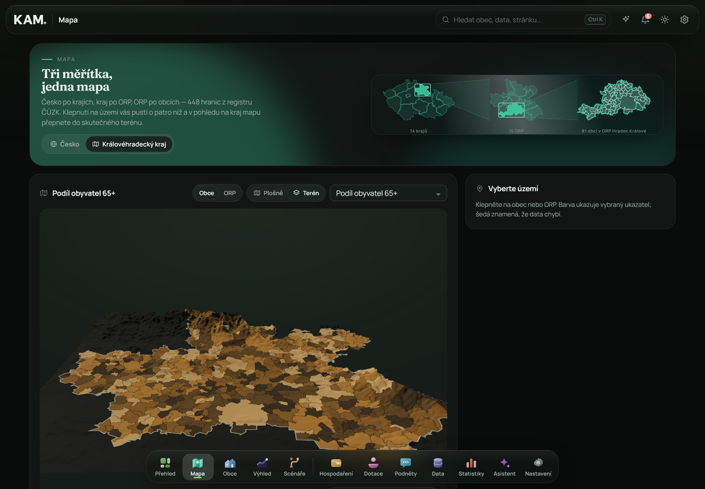

<div align="center">

# KAM

### Krajský analytický model

**Vidět, kam to směřuje.**

Živý model Královéhradeckého kraje nad otevřenými daty: co se děje, proč,
kam to vede — a co se změní, když zasáhneme, nebo nezasáhneme.

[](LICENSE)
[](https://www.python.org/)
[](https://react.dev/)
[](#testy)

Tým **Popojedem.** · Hackathon Královéhradeckého kraje


</div>

---

## Co to je

Kraj má data. Má jich hodně a jsou otevřená — jenže leží v katalozích po
stovkách sad a nikdo z nich nepozná, že v Horním Testově za deset let ubyla
pětina lidí a za další čtyři roky tam nebude dost dětí na druhý stupeň.

KAM z těch sad staví jeden model: profil každé obce, rizika s důkazy, výhled
do roku 2040 a simulátor „co kdyby". Nad vším je asistent, který umí odpovědět
větou — ale čísla nepočítá on, ty mu podává model.

**Každé číslo v aplikaci se počítá z databáze.** Žádné se nepíše do textu
stránky. Když zdroj nic neví, aplikace to řekne, místo aby si domyslela.

## Jak to vypadá

Snímky jsou z běžící aplikace, ne z návrhu — čísla na nich jsou ta, která
v ten okamžik vyšla z databáze.

### Přehled kraje

Rizika seřazená podle závažnosti, puls kraje a výhled na jedné obrazovce.
Každé riziko má důkaz a odkaz na území, kterého se týká.


### Mapa v terénu

Kartogram natažený přes skutečný výškový model z ČÚZK DMR 5G. Převýšení se dá
nastavit, najetím zjistíte obec, hodnotu i nadmořskou výšku.



### Obce

Všech 448 obcí kraje najednou: jedna tečka je jedna obec, plocha odpovídá
počtu obyvatel a osa je logaritmická — jinak by se devadesát procent obcí
slilo do jednoho chumlu a zbyl by jeden puntík vpravo.


### Profil území

Devět oblastí, u každého ukazatele poslední hodnota, srovnání s krajem, zdroj
a vyhodnocení trendu. Tvar grafu si ukazatel vybírá sám podle toho, co měří.


### Co kdyby? — simulátor

Vlevo se scénář staví (hotové sady, osm druhů zásahů, přepsatelné
předpoklady), vpravo běží stejný model dvakrát — bez zásahu a s ním.


### Výhled 2026–2040

Tři scénáře počtu obyvatel a věkové struktury, pásmo z 400 Monte Carlo běhů
a zpětný test modelu.


### Hospodaření obce

Kolik zbyde z provozu, kolik jde do majetku a jestli si to obec platí sama.
Hodnocení je pravidlo s vypsanými prahy, ne dojem.


### Dotace

Kolik do území doteklo, jak si stojí proti ostatním a kam se obrátit pro
další.


### Podněty občanů

Jedno hlášení je stížnost. Pět podobných ze stejné obce je doklad — KAM je
spojí, přiloží čísla z modelu a vznikne formální podnět pro kraj.


### Otevřená data

Celý katalog, ze kterého KAM čerpá: u každé sady ověřený odkaz a popsané
využití. Plocha dlaždice odpovídá počtu sad v oblasti.


### Statistiky

Kolik toho model drží, spočítané po tečkách. Jedna tečka je tisíc měřených
hodnot a čím světlejší, tím novější — první roky jsou tenké, poslední se
teprve plní.


## Stav dat

Snímek z posledního sběru — počty se v aplikaci počítají živě, tohle je jen
pro představu:

| | |
|---|---:|
| Datových sad v katalogu | **24 273** |
| z toho s ověřeným odkazem | **22 432** |
| Poskytovatelů dat | **394** |
| Naměřených hodnot (2005–2026) | **407 214** |
| Území (kraj, okresy, ORP, obce) | **483** |
| Zařízení a zastávek | **11 616** |
| Ukazatelů | **138** |

## Spuštění

| Systém | Příkaz |
|---|---|
| Windows | dvojklik na `start.bat` (nebo `.\start.ps1`) |
| macOS / Linux | `./start.sh` |

Skript vytvoří virtuální prostředí, nainstaluje závislosti, sestaví frontend
a při prvním spuštění stáhne otevřená data (několik minut). Aplikace poběží
na <http://127.0.0.1:8000>.

- `-Lan` / `--lan` zpřístupní aplikaci v místní síti (test na telefonu)
- `-Refresh` / `--refresh` znovu stáhne data

Požadavky: Python 3.10+, Node.js 20+ (jen pro sestavení frontendu).
Volitelně [LM Studio](https://lmstudio.ai) s modelem `google/gemma-4-e4b`
a `text-embedding-nomic-embed-text-v1.5`.

Cloudový model stačí zapnout klíčem: `GEMINI_API_KEY` v `.env` a poskytovatel
se založí sám při startu. Bez jakéhokoli modelu aplikace funguje dál —
asistent pak odpovídá přímo z dat a vyhledávání běží přes BM25.

## Co umí

**Analytická vrstva** — živé profily obcí, ORP, okresů a kraje v devíti
oblastech. U každého ukazatele poslední hodnota, rok, srovnání s krajem, zdroj
a vyhodnocení *trend / jednorázový výkyv / stabilní*. Tvar grafu si ukazatel
vybírá sám podle toho, co měří: podíl dostane ciferník, roční tok sloupce,
stav plochu, jednorázový počet značky.

**Rizika** — pravidla nad daty, ne prompt. Každé riziko má pět stupňů
závažnosti, důvěru (klesá u malých obcí a krátkých řad) a důkazy s odkazem na
zdroj.

**Výhled 2026–2040** — komponentní model ve třech scénářích. Porodnost se váže
na podíl lidí v produktivním věku, úmrtnost na podíl 65+, migrace se vrací
k dlouhodobému mediánu. Pásmo není vzorec: 400 Monte Carlo běhů losuje míry
z vlastní historie území. Součástí je zpětný test.

**Simulátor „Co kdyby?"** — zásahy (byty, místa v ZŠ a MŠ, spoje, pracovní
místa, lůžka, ordinace), srovnání bez zásahu a se zásahem, varování před
přetížením kapacit a řetězec dopadů, kde je u každého kroku napsáno, jestli je
to fakt z dat, výsledek modelu, nebo předpoklad. Každý předpoklad je vidět a
lze ho přepsat.

**Podněty občanů** — anonymizace, seskupování podobných hlášení, formální
podnět kraji po dosažení prahu.

**Mapa ve dvou rozměrech i ve třech** — kraj po obcích a po ORP, plošně nebo
jako terén. Ve 3D je stejná kartogramová barva natažená přes skutečný výškový
model ČÚZK DMR 5G, převýšení si nastavíte posuvníkem, najetím zjistíte obec
i nadmořskou výšku. Mapa je vlastní kresba — žádné dlaždice, žádný klíč.

**Datové potřeby** — matice pokrytí ORP × oblast, čerstvost sad podle
periodicity, strukturální mezery. Aplikace hlídá i data samotná.

**Asistent** — příkazy aplikace bez modelu („zapni tmavý režim"), router mezi
lokálním a cloudovým modelem, hybridní RAG nad celým katalogem, citace zdrojů
a ochrana proti jailbreaku i prompt injection.

## Architektura

```
frontend/            React + TypeScript + Vite, vlastní CSS, SVG grafy a mapy
                     — žádná UI knihovna, žádná grafová knihovna
backend/kam/
  ingest/            sklizeň NKOD, DCAT, ČSÚ MOS, Data KHK, ČÚZK
  analytics/         trendy, profily, rizika, výhled, simulace, datové potřeby
  ai/                poskytovatelé modelů, router, RAG, nástroje, ochrana
  api/               REST + SSE (dokumentace na /api/docs)
data/                SQLite databáze a geometrie (vzniká ingestem, není v gitu)
```

Databáze: SQLite (výchozí) nebo PostgreSQL přes `DATABASE_URL`.
Konfigurace v `.env` — viz [`.env.example`](.env.example).

### Co drží produkt poctivý

- `Observation` obsahuje jen publikované hodnoty. Výhled a simulace se
  počítají při čtení a nikdy se nezapisují zpět — realita se z „co kdyby"
  přepsat nedá.
- `Dataset.loaded` nastavuje jen `ingest/link.py`, a to jen u sad, jejichž
  hodnoty sklízeč opravdu přečetl.
- Předpoklady v `analytics/simulate.py` nesou hodnotu i důvod a jdou přepsat
  pro každý požadavek.
- Jazykový model nepočítá čísla. `ai/tools.py` mu podává označený podklad
  (FAKT / TREND / MODEL / SCÉNÁŘ) a model ho vysvětluje.

## Data

Každá sada v katalogu má odkaz na zdroj a uvedené využití. Hlavní číslo
zahrnuje jen sady, jejichž odkaz při poslední kontrole odpověděl. Nefunkční
odkazy a sady bez odkazu jsou v katalogu vidět zvlášť.

| Zdroj | Jak se používá |
|---|---|
| NKOD (SPARQL) — všichni poskytovatelé | katalog, asistent, pokrytí, čerstvost, mapa |
| Eurostat — regionální statistika NUTS3 CZ052 a NUTS2 CZ05 | katalog, asistent (jen sady, které o kraji opravdu mají hodnoty) |
| Krajské a městské portály (DCAT-AP, ArcGIS Hub) | katalog (duplicity sloučeny) |
| Lokální katalogy OFN (Hradec Králové, Praha) | katalog |
| Národní geoportál INSPIRE (CENIA, CSW) | katalog |
| ČSÚ — Městská a obecní statistika, 2005–2025 | hodnoty ukazatelů pro všechny obce |
| Data KHK přes ArcGIS REST — přes 40 vrstev | zařízení, fakta a hodnoty v obcích |
| ČÚZK RÚIAN | hranice kraje, ORP a obcí |
| ČÚZK DMR 5G | výškový model kraje pro 3D mapu |

**Pravidla sklizně**, na která se snadno šlápne:

- Z NKOD se stránkuje po jmenovitých dávkách IRI, ne přes výsledky. Metadatový
  dotaz vynechá sadu bez českého názvu, takže plná stránka může přijít
  neúplná — a pravidlo „krátká stránka = poslední" dřív sklizeň ukončilo asi
  po dvou pětinách každého poskytovatele.
- Duplicity se hledají dvakrát: shodou normalizovaného názvu v rámci kraje a
  shodou odkazu ke stažení. Index se staví znovu pro každý zdroj a vždy bez
  jeho vlastních řádků.
- Denní řezy jedné řady se slučují do jedné sady, pokud jich je aspoň 30.
  Úřad pro technické prohlídky sám registruje přes deset tisíc denních
  souborů; počítat je jeden po druhém by katalog nafouklo, ne obohatilo.
- Z Eurostatu se nebere katalog, ale ověřený průnik: u každé z bezmála devíti
  tisíc sad se zvlášť zeptáme na hodnoty za `CZ052` a `CZ05` a zapíšeme jen tu,
  která odpoví. Odkaz ke stažení míří na týž dotaz, takže vrací data o kraji.

Ruční aktualizace:

```bash
cd backend && python -m kam.ingest all
```

Kroky jdou spouštět i jednotlivě: `geo`, `relief`, `catalog`, `eurostat`,
`mos`, `khk`, `link`, `check`, `rag`. Každý je idempotentní. `relief` běží až
po `geo`, protože si z hranic bere projekci; `eurostat` trvá kolem deseti
minut, protože každou sadu ověřuje.

## Testy

```bash
python -m pytest              # 89 testů
cd frontend && npm test       # 9 testů
```

## Nasazení

Postup je v [DEPLOY.md](DEPLOY.md). Ve zkratce: aplikace je jeden kontejner
(`Dockerfile`), data leží v PostgreSQL (`DATABASE_URL`) a snímek se tam nahraje
skriptem `scripts/migrate_to_postgres.py`. Nasazená aplikace je veřejná a bez
přihlašování — otevřená data jsou otevřená.

## Licence

[MIT](LICENSE) — tým Popojedem., 2026.
