<div align="center">

# KAM

### Krajský analytický model

**Vidět, kam to směřuje.**

Živý model Královéhradeckého kraje nad otevřenými daty: co se děje, proč,
kam to vede — a co se změní, když zasáhneme, nebo nezasáhneme.

[](LICENSE)
[](https://www.python.org/)
[](https://react.dev/)
[](docs/API.md)
[](#testy)

**[Živá aplikace](https://hack-a-ton-hushkys.web.app)** · **[Otevřené API](docs/API.md)** · **[Web týmu](https://popojedem-web.web.app/#top)**

Tým **[Popojedem.](https://popojedem-web.web.app/#top)** · Hackathon Královéhradeckého kraje

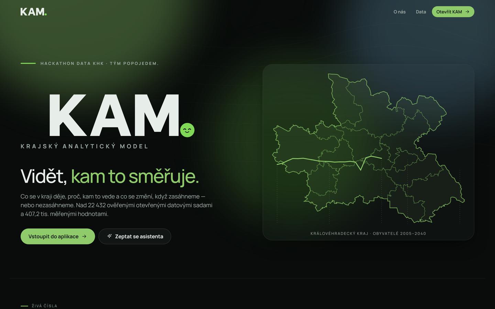

*Úvodní stránka je jeden dlouhý hook: kraj a jeho výhled do roku 2040 v jednom
obrázku, živá čísla, která se natočí, až na ně dojedete, a dvě vodorovná
dějství — cesta modelu v pěti krocích a čtyři vrstvy — kterými svislé rolování
veze dráhu do strany. Na telefonu je z nich posuv prstem.*

</div>

---

## Co to je

Kraj má data. Má jich hodně a jsou otevřená — jenže leží v katalozích po
stovkách sad a nikdo z nich nepozná, že v Horním Testově za deset let ubyla
pětina lidí a za další čtyři roky tam nebude dost dětí na druhý stupeň.

KAM z těch sad staví jeden model: profil každé obce, rizika s důkazy, výhled
do roku 2040 a simulátor „co kdyby". Nad vším je asistent, který umí odpovědět
větou — ale čísla nepočítá on, ty mu podává model.

**Každé číslo v aplikaci se počítá z databáze.** Žádné se nepíše do textu
stránky. Když zdroj nic neví, aplikace to řekne, místo aby si domyslela.

## Otevřené API

Data nezůstávají uvnitř aplikace. Všechno, co KAM posbíral, si kdokoli stáhne
jedním rozhraním — **bez klíče, bez registrace, bez omezení počtu dotazů**:

```bash
curl https://hack-a-ton-hushkys.web.app/api/v1
```

To je rozcestník: vypíše, co tu je, kolik toho je a jak se ptát. `cesty`
a `priklady` v odpovědi jsou funkční adresy, takže se dá začít pracovat bez
čtení dokumentace.

```bash
# Počet obyvatel všech obcí od roku 2020, rovnou do tabulky
curl -o obce.csv "…/api/v1/hodnoty?ukazatel=110900&uroven=obec&od=2020&format=csv"

# Všechno, co model ví o jedné obci
curl "…/api/v1/hodnoty?uzemi=obec:569810"
```

Jeden řádek je jedno číslo: území, ukazatel, rok, hodnota, **a původce**. Nic se
nedopočítává — podíly a přepočty si aplikace počítá až při čtení, takže v API
je jen to, co někdo doopravdy zveřejnil.

| | |
|---|---|
| Formáty | `json` se stránkováním, `csv` pro tabulky, `ndjson` pro velké dávky |
| Streamování | CSV a NDJSON nemají strop — projde jimi celá databáze |
| Z prohlížeče | `Access-Control-Allow-Origin: *`, jen na `/api/v1` |
| Napojení | `id` území je kód RÚIAN, takže data sednou na jiné registry |

Celý návod je v **[docs/API.md](docs/API.md)**, strojový popis na `/api/docs`.
V repozitáři je i [`scripts/kam.py`](scripts/kam.py) — klient do příkazové
řádky, který si vystačí se standardní knihovnou Pythonu:

```bash
python scripts/kam.py info
python scripts/kam.py ukazatele --hledat lékař
python scripts/kam.py data --ukazatel 110900 --uzemi obec:569810
python scripts/kam.py stahni hodnoty --format csv --do-souboru vse.csv
```

## Jak to vypadá

Snímky jsou z běžící aplikace, ne z návrhu — čísla na nich jsou ta, která
v ten okamžik vyšla z databáze.

### Přehled kraje

Rizika seřazená podle závažnosti, puls kraje a výhled na jedné obrazovce.
Každé riziko má důkaz a odkaz na území, kterého se týká.

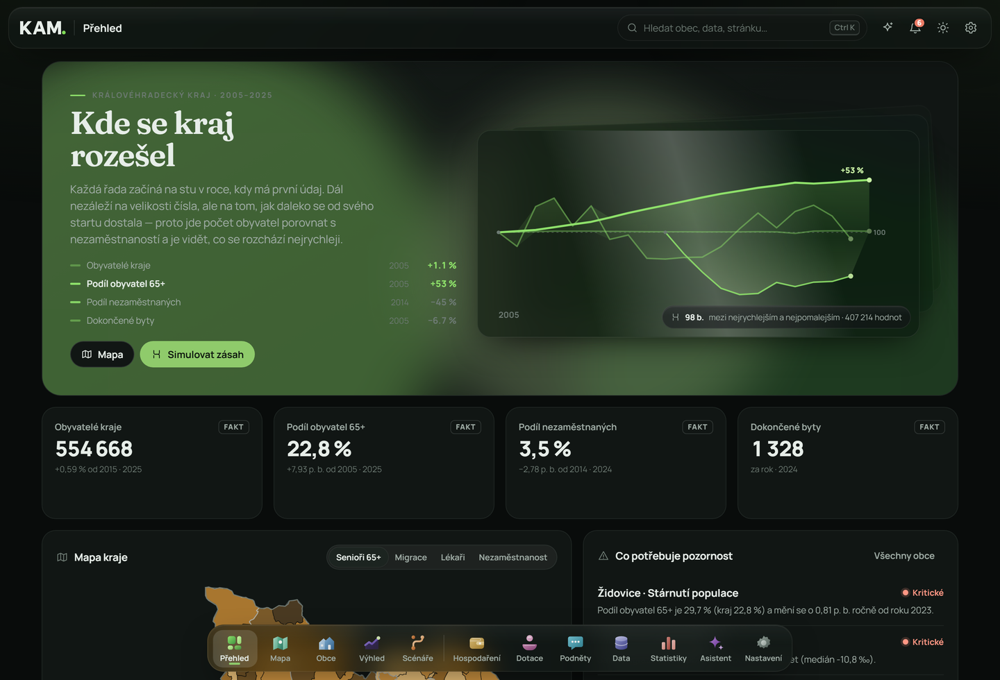

### Mapa

Česko po krajích a kraj po obcích nebo správních obvodech ORP. Barva ukazuje
vybraný ukazatel, klepnutím na území se otevře jeho detail a mapu jde
přiblížit tlačítky i dvěma prsty.

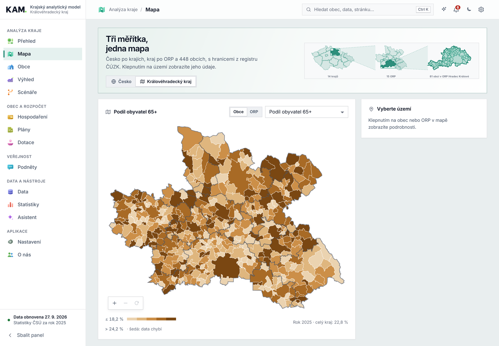

### Obce

Všech 448 obcí kraje najednou: jedna tečka je jedna obec, plocha odpovídá
počtu obyvatel a osa je logaritmická — jinak by se devadesát procent obcí
slilo do jednoho chumlu a zbyl by jeden puntík vpravo.

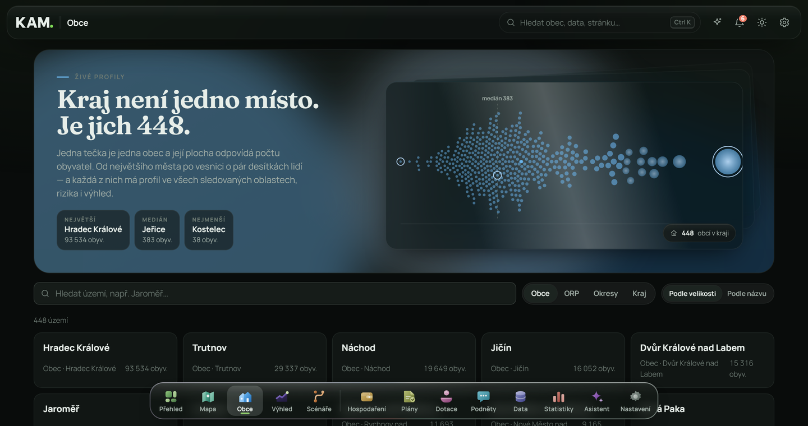

### Profil území

Devět oblastí, u každého ukazatele poslední hodnota, srovnání s krajem, zdroj
a vyhodnocení trendu. Tvar grafu si ukazatel vybírá sám podle toho, co měří.

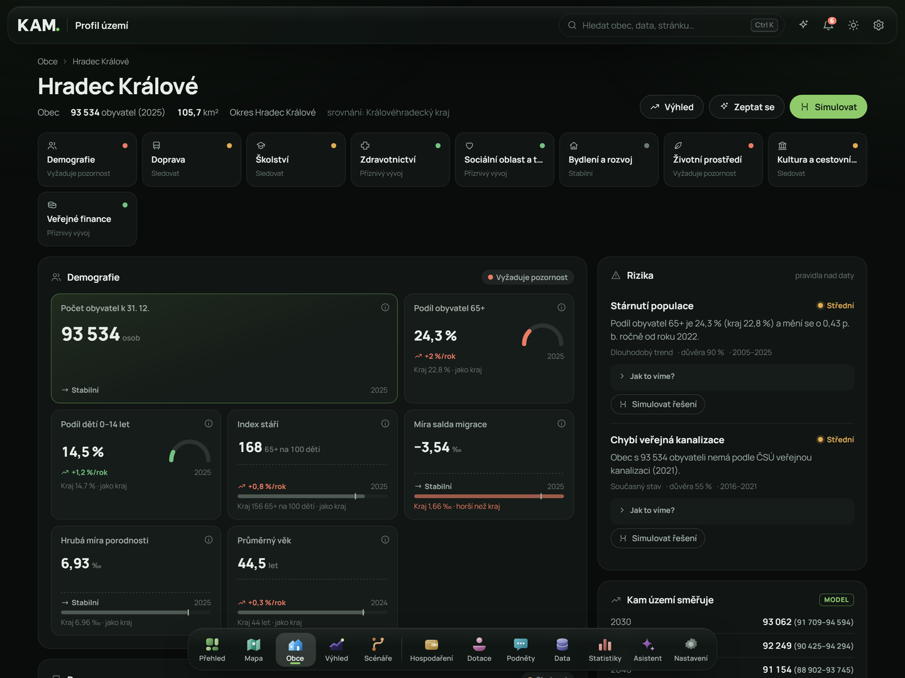

### Co kdyby? — simulátor

Vlevo se scénář staví (hotové sady, osm druhů zásahů, přepsatelné
předpoklady), vpravo běží stejný model dvakrát — bez zásahu a s ním.

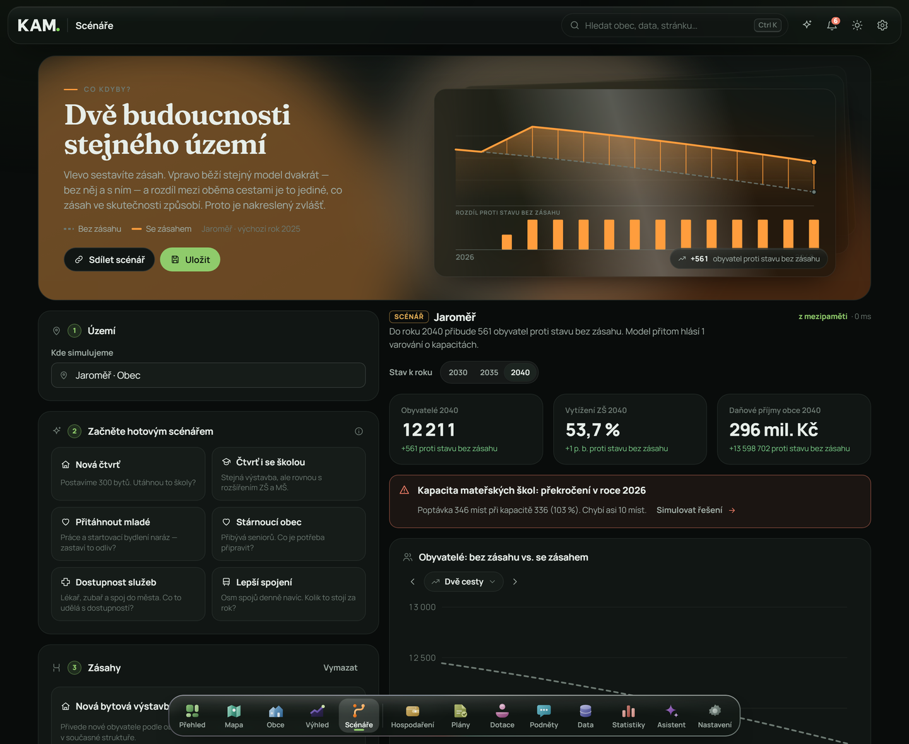

### Výhled 2026–2040

Tři scénáře počtu obyvatel a věkové struktury, pásmo z 400 Monte Carlo běhů
a zpětný test modelu.

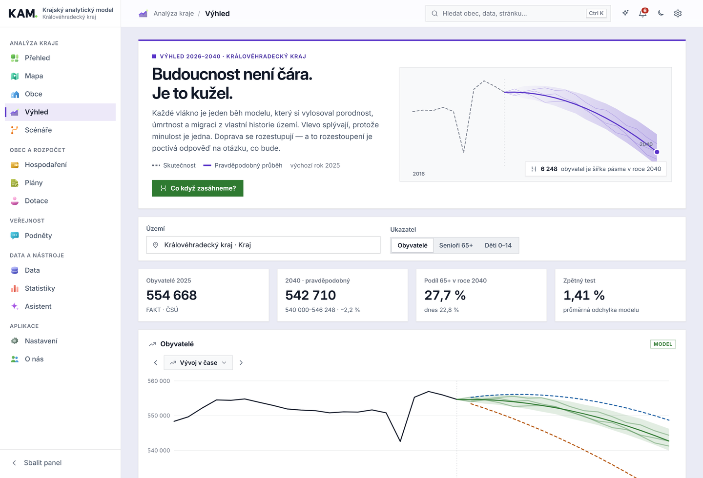

### Hospodaření obce

Kolik zbyde z provozu, kolik jde do majetku a jestli si to obec platí sama.
Hodnocení je pravidlo s vypsanými prahy, ne dojem.

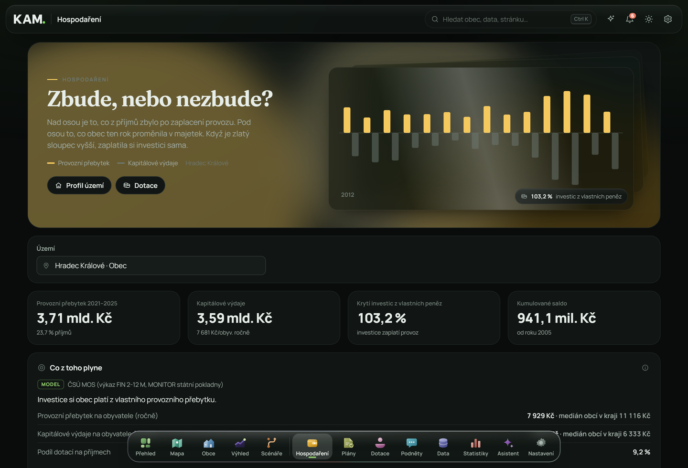

### Dotace

Kolik do území doteklo, jak si stojí proti ostatním a kam se obrátit pro
další.

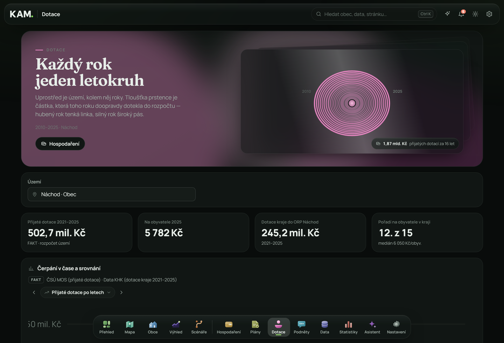

### Plány

Rejstřík všech 448 obcí kraje a 2 913 jejich dokumentů. U každé obce čtyři
povinnosti — program rozvoje, územní plán i s každou změnou, rozpočet a otevřená
data — a u každé buď dokument s datem a odkazem, nebo věta, že chybí. Odkaz míří
rovnou na ten dokument, ne na vyhledávací formulář.

Stránka schválně nevypadá jako zbytek aplikace: není to nástěnka s dlaždicemi,
ale výpis, ve kterém se řádek rozbalí na místě. Do okna se tak vejde dvacet obcí
místo pěti.

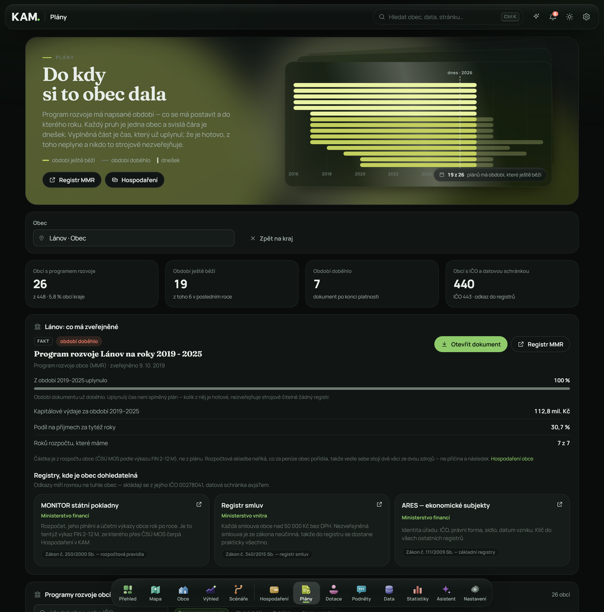

### Podněty občanů

Jedno hlášení je stížnost. Pět podobných ze stejné obce je doklad — KAM je
spojí, přiloží čísla z modelu a vznikne formální podnět pro kraj.

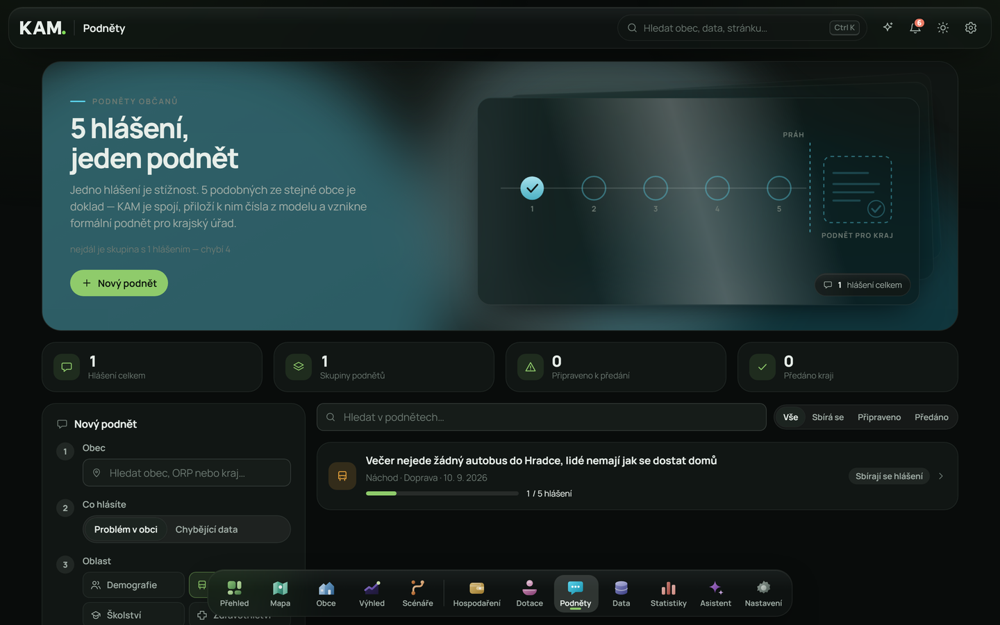

### Asistent

Neotevře se chat, ale pole. Uprostřed pozdrav, jedna věta a řádek — a jakmile
odejde první otázka, pole sjede dolů a nad ním se rozbalí rozhovor. Odpovídá
z dat KAM, ovládá aplikaci a u každého čísla ukáže zdroj.

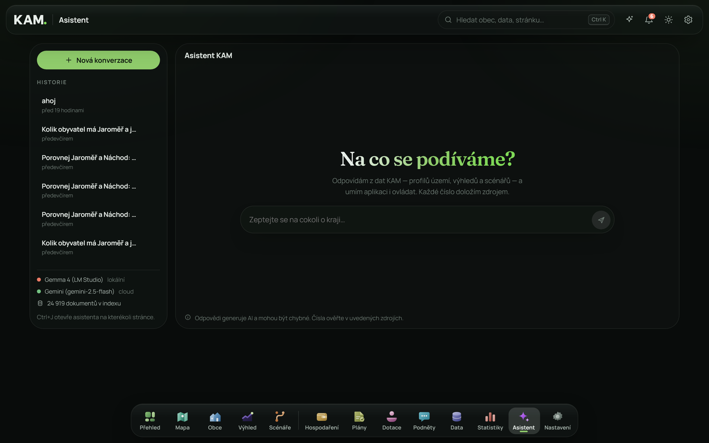

### Otevřená data

Celý katalog, ze kterého KAM čerpá: u každé sady ověřený odkaz a popsané
využití. Plocha dlaždice odpovídá počtu sad v oblasti.

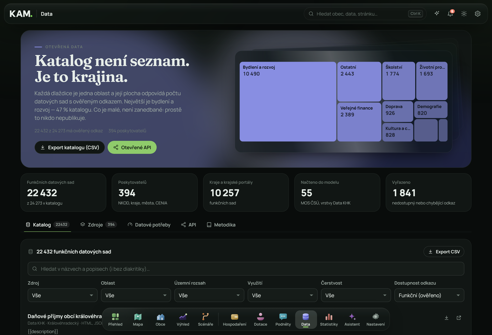

### API pro všechny

Jedno rozhraní na všechna data, živé ukázky ke zkopírování a klient do
příkazové řádky. Kdo si aplikaci vezme pod sebe, nemusí obcházet dvacet
katalogů.

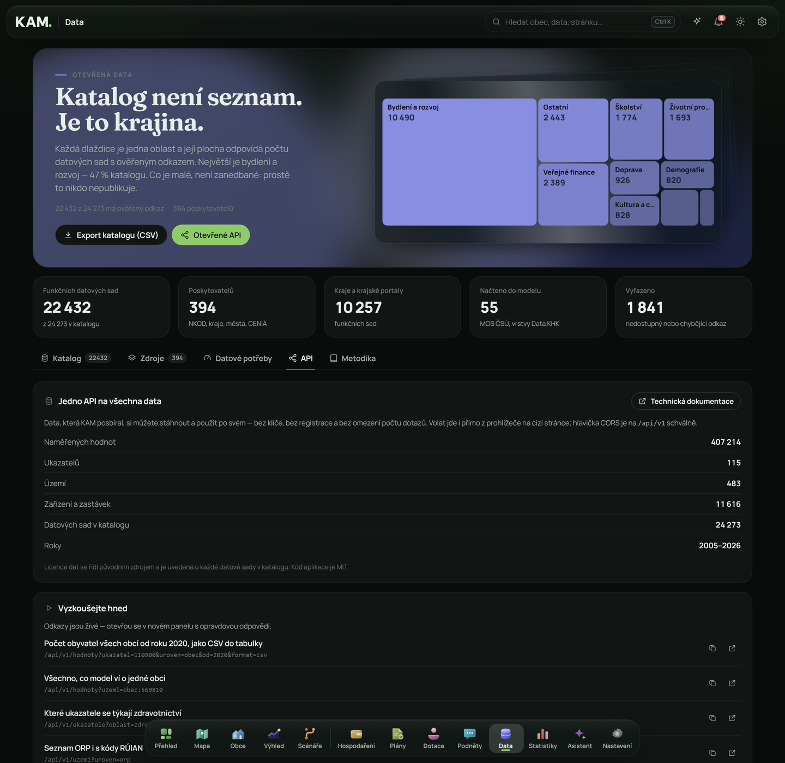

### Statistiky

Kolik toho model drží, spočítané po tečkách. Jedna tečka je tisíc měřených
hodnot a čím světlejší, tím novější — první roky jsou tenké, poslední se
teprve plní.

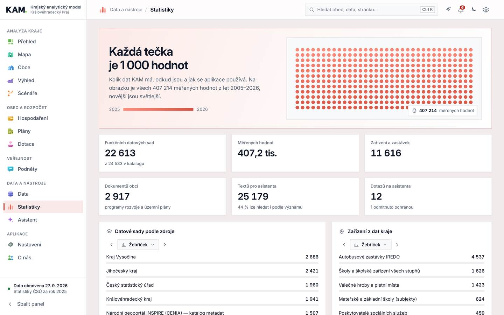

## Stav dat

Snímek z posledního sběru — počty se v aplikaci počítají živě, tohle je jen
pro představu:

| | |
|---|---:|
| Datových sad v katalogu | **24 273** |
| z toho s ověřeným odkazem | **22 432** |
| Poskytovatelů dat | **394** |
| Naměřených hodnot (2005–2026) | **407 214** |
| Území (kraj, okresy, ORP, obce) | **483** |
| Zařízení a zastávek | **11 616** |
| Ukazatelů | **115** |
| Nečíselných údajů | **2 233** |

Všechna tahle čísla vrátí `GET /api/v1` živě.

## Spuštění

| Systém | Příkaz |
|---|---|
| Windows | dvojklik na `start.bat` (nebo `.\start.ps1`) |
| macOS / Linux | `./start.sh` |

Skript vytvoří virtuální prostředí, nainstaluje závislosti, sestaví frontend
a při prvním spuštění stáhne otevřená data (několik minut). Aplikace poběží
na <http://127.0.0.1:8000>.

- `-Lan` / `--lan` zpřístupní aplikaci v místní síti (test na telefonu)
- `-Refresh` / `--refresh` znovu stáhne data

Požadavky: Python 3.10+, Node.js 20+ (jen pro sestavení frontendu).
Volitelně [LM Studio](https://lmstudio.ai) s modelem `google/gemma-4-e4b`
a `text-embedding-nomic-embed-text-v1.5`.

Cloudový model stačí zapnout klíčem: `GEMINI_API_KEY` v `.env` a poskytovatel
se založí sám při startu. Bez jakéhokoli modelu aplikace funguje dál —
asistent pak odpovídá přímo z dat a vyhledávání běží přes BM25.

## Co umí

**Analytická vrstva** — živé profily obcí, ORP, okresů a kraje v devíti
oblastech. U každého ukazatele poslední hodnota, rok, srovnání s krajem, zdroj
a vyhodnocení *trend / jednorázový výkyv / stabilní*. Tvar grafu si ukazatel
vybírá sám podle toho, co měří: podíl dostane ciferník, roční tok sloupce,
stav plochu, jednorázový počet značky.

**Povinně zveřejňované dokumenty** — 2 913 dokumentů všech 448 obcí kraje:
programy rozvoje z registru MMR s obdobím platnosti, územní plány a všechny
jejich změny z evidence kraje, rozpočty z MONITORu a otevřená data z NKOD.
K tomu přesné odkazy do registru smluv a ARESu složené z IČO té konkrétní obce.
Kolik z plánu je hotové, aplikace netvrdí: takový registr v Česku neexistuje
a odhadovat to z názvů kapitol by bylo vymýšlení.

**Rizika** — pravidla nad daty, ne prompt. Každé riziko má pět stupňů
závažnosti, důvěru (klesá u malých obcí a krátkých řad) a důkazy s odkazem na
zdroj.

**Výhled 2026–2040** — komponentní model ve třech scénářích. Porodnost se váže
na podíl lidí v produktivním věku, úmrtnost na podíl 65+, migrace se vrací
k dlouhodobému mediánu. Pásmo není vzorec: 400 Monte Carlo běhů losuje míry
z vlastní historie území. Součástí je zpětný test.

**Simulátor „Co kdyby?"** — zásahy (byty, místa v ZŠ a MŠ, spoje, pracovní
místa, lůžka, ordinace), srovnání bez zásahu a se zásahem, varování před
přetížením kapacit a řetězec dopadů, kde je u každého kroku napsáno, jestli je
to fakt z dat, výsledek modelu, nebo předpoklad. Každý předpoklad je vidět a
lze ho přepsat.

**Podněty občanů** — anonymizace, seskupování podobných hlášení, formální
podnět kraji po dosažení prahu.

**Mapa** — Česko po krajích, kraj po obcích a po ORP, s přiblížením a detailem vybraného území. Mapa je vlastní kresba — žádné dlaždice, žádný klíč.

**Chybějící data** — matice pokrytí ORP × oblast, čerstvost sad podle
periodicity, strukturální mezery. Aplikace hlídá i data samotná.

**Asistent** — příkazy aplikace bez modelu („zapni tmavý režim"), router mezi
lokálním a cloudovým modelem, hybridní RAG nad celým katalogem, citace zdrojů
a ochrana proti jailbreaku i prompt injection. Otevírá se jako pole, ne jako
prázdný chat; rozhovor se rozbalí až s první odpovědí.

**Vyhledávání přes celou aplikaci** — jedno pole (Ctrl+K nebo `/`) na území,
datové sady, ukazatele, metodiku, stránky i příkazy. Výsledky jsou rozdělené
do kategorií a řadí se podle shody, takže „rozpočet" vrátí Hospodaření dřív
než cizí sadu, která to slovo má v názvu. Hledá se i podle kódu RÚIAN.

**Na telefonu** — přejetím prstem se přepíná mezi místy v navigaci, aplikace
se dá nainstalovat a funguje i bez signálu; v tom případě přizná, že čísla
jsou z poslední návštěvy. Veškerý pohyb se dá vypnout jedním přepínačem ve
Vzhledu — pro slabší telefony i pro každého, komu animace vadí.

## Architektura

```
frontend/            React + TypeScript + Vite, vlastní CSS, SVG grafy a mapy
                     — žádná UI knihovna, žádná grafová knihovna
backend/kam/
  ingest/            sklizeň NKOD, DCAT, ČSÚ MOS, Data KHK, ČÚZK
  analytics/         trendy, profily, rizika, výhled, simulace, datové potřeby
  ai/                poskytovatelé modelů, router, RAG, nástroje, ochrana
  api/               REST + SSE (dokumentace na /api/docs)
data/                SQLite databáze a geometrie (vzniká ingestem, není v gitu)
```

Databáze: SQLite (výchozí) nebo PostgreSQL přes `DATABASE_URL`.
Konfigurace v `.env` — viz [`.env.example`](.env.example).

### Co drží produkt poctivý

- `Observation` obsahuje jen publikované hodnoty. Výhled a simulace se
  počítají při čtení a nikdy se nezapisují zpět — realita se z „co kdyby"
  přepsat nedá.
- `Dataset.loaded` nastavuje jen `ingest/link.py`, a to jen u sad, jejichž
  hodnoty sklízeč opravdu přečetl.
- Předpoklady v `analytics/simulate.py` nesou hodnotu i důvod a jdou přepsat
  pro každý požadavek.
- Jazykový model nepočítá čísla. `ai/tools.py` mu podává označený podklad
  (FAKT / TREND / MODEL / SCÉNÁŘ) a model ho vysvětluje.

## Data

Každá sada v katalogu má odkaz na zdroj a uvedené využití. Hlavní číslo
zahrnuje jen sady, jejichž odkaz při poslední kontrole odpověděl. Nefunkční
odkazy a sady bez odkazu jsou v katalogu vidět zvlášť.

| Zdroj | Jak se používá |
|---|---|
| NKOD (SPARQL) — všichni poskytovatelé | katalog, asistent, pokrytí, čerstvost, mapa |
| Eurostat — regionální statistika NUTS3 CZ052 a NUTS2 CZ05 | katalog, asistent (jen sady, které o kraji opravdu mají hodnoty) |
| Krajské a městské portály (DCAT-AP, ArcGIS Hub) | katalog (duplicity sloučeny) |
| Lokální katalogy OFN (Hradec Králové, Praha) | katalog |
| Národní geoportál INSPIRE (CENIA, CSW) | katalog |
| ČSÚ — Městská a obecní statistika, 2005–2025 | hodnoty ukazatelů pro všechny obce |
| Data KHK přes ArcGIS REST — přes 40 vrstev | zařízení, fakta a hodnoty v obcích |
| obcepro.cz (MMR) — programy rozvoje obcí | dokumenty s obdobím platnosti, stránka Plány |
| Evidence ÚPD Královéhradeckého kraje | územní plány obcí a jejich změny s datem vydání |
| ARES (MF) — ekonomické subjekty | IČO úřadů, párované na kód obce z RÚIAN |
| Registr práv a povinností (MV) — seznam OVM | datové schránky úřadů |
| ČÚZK RÚIAN | hranice kraje, ORP a obcí |

**Pravidla sklizně**, na která se snadno šlápne:

- Z NKOD se stránkuje po jmenovitých dávkách IRI, ne přes výsledky. Metadatový
  dotaz vynechá sadu bez českého názvu, takže plná stránka může přijít
  neúplná — a pravidlo „krátká stránka = poslední" dřív sklizeň ukončilo asi
  po dvou pětinách každého poskytovatele.
- Duplicity se hledají dvakrát: shodou normalizovaného názvu v rámci kraje a
  shodou odkazu ke stažení. Index se staví znovu pro každý zdroj a vždy bez
  jeho vlastních řádků.
- Denní řezy jedné řady se slučují do jedné sady, pokud jich je aspoň 30.
  Úřad pro technické prohlídky sám registruje přes deset tisíc denních
  souborů; počítat je jeden po druhém by katalog nafouklo, ne obohatilo.
- Z Eurostatu se nebere katalog, ale ověřený průnik: u každé z bezmála devíti
  tisíc sad se zvlášť zeptáme na hodnoty za `CZ052` a `CZ05` a zapíšeme jen tu,
  která odpoví. Odkaz ke stažení míří na týž dotaz, takže vrací data o kraji.

Ruční aktualizace:

```bash
cd backend && python -m kam.ingest all
```

Kroky jdou spouštět i jednotlivě: `geo`, `catalog`, `eurostat`, `mos`, `khk`,
`dotace`, `dokumenty`, `link`, `check`, `rag` a `refresh` (denní obnova, viz
DEPLOY.md). Každý je idempotentní; `eurostat` trvá kolem deseti minut, protože
každou sadu ověřuje.

## Testy

```bash
python -m pytest              # 128 testů
cd frontend && npm test       # 17 testů
```

Testy hlídají i věci, které se snadno rozbijí potichu: že nasazená aplikace
nikde nevrací 401 (`test_aplikace_je_verejna`), že veřejné API posílá CORS jen
na `/api/v1`, že CSV má BOM kvůli Excelu a že ke každé hodnotě patří původce.

## Nasazení

Postup je v [DEPLOY.md](DEPLOY.md). Ve zkratce: aplikace je jeden kontejner
(`Dockerfile`), data leží v PostgreSQL (`DATABASE_URL`) a snímek se tam nahraje
skriptem `scripts/migrate_to_postgres.py`. Nasazená aplikace je veřejná a bez
přihlašování — otevřená data jsou otevřená.

Server naběhne i tehdy, když databáze mlčí: `/api/health` v tu chvíli vrátí
`ok: false` i s důvodem a aplikace se sama vrátí do provozu, jakmile databáze
naskočí. Je to schválně — kontejner, který se kvůli databázi vůbec nerozběhne,
je z venku k nerozeznání od smazané aplikace a nejde nahradit ani opravenou
verzí.

## Licence

[MIT](LICENSE) — tým Popojedem., 2026.
